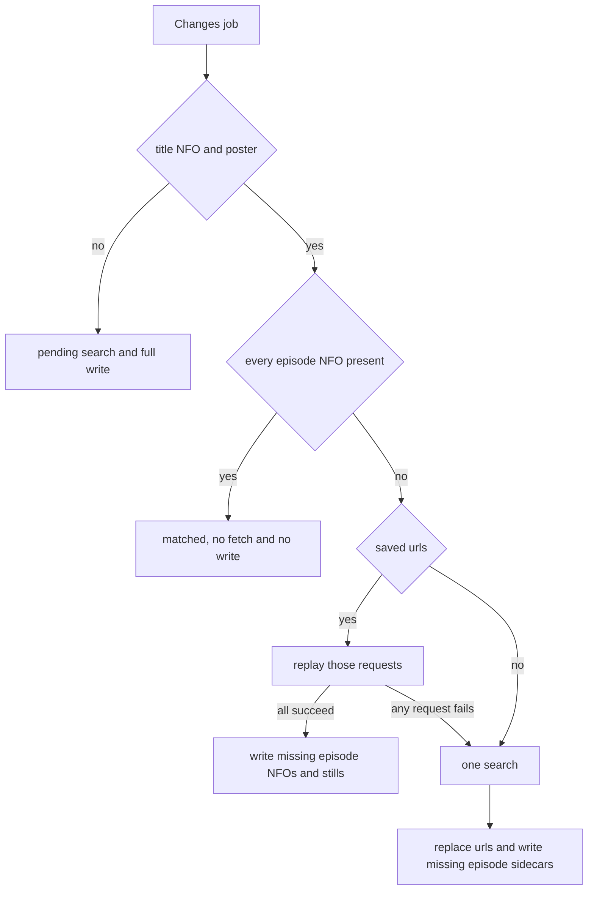

# MatchMedia manual
---
- **MatchMedia** is a statistical engine for directory hierarchy discovery of media libraries, title extraction and grouping, metadata search-and-fetch from YAML providers (shipped [TMDB](https://developer.themoviedb.org/)), scoring and ranking candidates, and mapping them to the appropriate files.
- **MatchMedia** can ingest a list of titles and search, fetch, and map metadata for them.
- **Module**: `github.com/alyshmahell/matchmedia/src`. 
- **Library import prefix**: `github.com/alyshmahell/matchmedia/src/mod`.

## Packages

1. `config` — Load overlay YAML. Return `*config.Config`.
2. `engine/group` — Cluster files on disk.
3. `engine/rank` — Score provider hits.
4. `fs` — Read directories. Walk video files.
5. `scan` — Group a library path. Apply a mode.
6. `ingest` — Parse CSV or JSON title rows.
7. `fetch` — Call metadata APIs from YAML.
8. `match` — Search, rank, and set job status.
9. `sidecar` — Read and write sidecar NFO next to the media.
10. `clean` — Strip comparison tags from folder and file names.

`cmd` is `package main`. It is not a library package.

## Load config

Call `config.New(overlayPath)`.

1. Load the shipped `default.yaml` that is embedded in `config`.
2. If `overlayPath` is not empty, merge that YAML on top. Overlay keys win.

Put the TMDB and OMDb keys in the overlay:

```yaml
providers:
  tmdb:
    api_key: YOUR_KEY
  omdb:
    api_key: YOUR_KEY
```

## Group files

`scan.Run` groups each immediate child of the scan path the same way as `experiments/`. Call `group.New(cfg).Group(dir)` for one folder.

1. A directory name that matches `group.season_pattern` is a season folder. All videos under season folders form one show. The show name is the child folder name.
2. Any other directory is a title folder. The engine clusters videos with character n-gram TF-IDF and average-linkage cosine distance, using the cleaned folder and file names. Constants are `group.parent_weight` and `group.distance_threshold`.
3. Loose video files beside seasons join the show unless their cluster is farthest from the season centroid. Farthest clusters become movie titles.
4. With no season folders, each loose file is one title.

Do not filter files by extra or kind labels. `files[]` keeps every video in the cluster.

## Modes

Pass the mode to `scan.Run`.

1. `rescan` — Ignore sidecars. Send every title to providers.
2. `changes` — A title NFO and poster with saved provider URLs are replayed. A failed replay, or a title with no saved URLs, is searched once. Missing episode NFOs and stills are written without replacing the title text or poster. A show whose episode NFOs are already present stays matched.
3. `missing` — Skip a title that has a title NFO. Send only titles with no title NFO.
4. `nfo` — Do not call providers. A complete sidecar is matched. An incomplete sidecar is unmatched.

A complete sidecar is a title NFO plus a poster. For `changes`, saved `<urls>` are the provider requests to replay. A show writes only episode NFOs and stills that are not already beside the video.



After that search, the existing `<urls>` block is replaced and only missing episode sidecars are written, while the title, plot, and poster stay.

## Match

```go
import (
	"github.com/alyshmahell/matchmedia/src/mod/config"
	"github.com/alyshmahell/matchmedia/src/mod/fetch"
	"github.com/alyshmahell/matchmedia/src/mod/match"
	"github.com/alyshmahell/matchmedia/src/mod/sidecar"
	"github.com/alyshmahell/matchmedia/src/mod/scan"
)

cfg, err := config.New("overlay.yaml")
client := fetch.New(cfg)
jobs, err := scan.Run(cfg, "/media/Shows", scan.ModeMissing)
for job := range match.Run(ctx, client, jobs) {
	_, err = sidecar.Write(ctx, client, []match.Job{job})
}
```

`match.Run` searches YAML providers, ranks hits with `rank.Rank(cfg, q, hits)`, and sets status:

- `matched` — Auto-match passed.
- `manual` — Hits exist. Auto-match failed.
- `unmatched` — No hits.
- `error` — Every wanted provider failed.

Rank uses Jaccard of title tokens plus a synopsis lift. Auto-match uses `match.min_score` and `match.min_margin`. Trailing `(YYYY)` is stripped from the search title; identical searches share one provider request. An empty full-title search retries word n-grams (n≥3) and ranks those hits against the original title.

Comparison names drop the configured `clean.tags`, one-word brackets, parentheses whose words are all tags, a trailing hyphen token, and 8-digit checksums before match and before the fold reads a season or episode. A four-digit year, a one- or two-digit parenthesis, and any block in `clean.keep` stay. The path on disk is unchanged.

`match.Run` always prepends a job for each scan parent folder (keyed by path) when children exist under that folder. A parent and its children are yielded together. Unmatched and error children fold into that parent when it is matched or manual. A folder whose cleaned name is a season, such as S01 or Season 2, folds too, even when that child matched or is manual. Files from a folded folder are numbered when they agree with one provider season, and left unnumbered otherwise. A movie or spinoff with no season token stays its own title. A season folder stays when the parent did not match. The parent job remains even when it has no files of its own.

Ingest a list instead of a scan:

```go
jobs, err := ingest.ParseJobs(cfg, reader, "titles.csv", "")
jobs = match.Collect(match.Run(ctx, client, jobs))
```

Import `github.com/alyshmahell/matchmedia/src/mod/ingest`.

Library callers do not write a report. Only the CLI writes markdown.

## Fetch and providers

`fetch` does not hard-code provider names. It expands YAML.

Each provider has `use`:

- `primary` — first wave. Always searched. Omit `use` to get `primary`.
- `defer` — second wave. Always searched after primary, even when primary returned hits.
- `fallback` — third wave. Searched only when primary and defer together returned no hits.

Shipped YAML:

- `tmdb` (`primary`) has two children: `movie` and `tv`. Shared keys stay on the parent (`base`, `api_key`, `poster_prefix`). Search `url`, `query`, `items`, and `fields` stay on each child's `search` section. Kind-specific keys stay on the child (`nfo`, `uniqueid`, `catalog`). Set `api_key` in overlay.
- `omdb` (`defer`) is a movie provider. It needs `api_key` in overlay. An empty key skips the defer wave.
- `tvmaze` (`fallback`) is a TV provider. It needs no key. `min_interval_ms` is set on `search` only.

A provider with one kind can keep `url`, `query`, `items`, and `fields` on the parent. Those load as its `search` section. Omit `movie` and `tv`. `min_interval_ms` on the provider paces every section. The same key on `search`, `titles`, `detail`, `episode`, or a catalog list replaces that default for that section.

`Candidate.Provider` is the YAML key (`tmdb`, `omdb`, `tvmaze`). `nfo` and `uniqueid` come from the spec that produced the hit.

## Sidecar

`sidecar.Write` writes NFO and posters next to `job.Path`. A show directory gets `tvshow.nfo` and `poster`. A movie directory gets `movie.nfo` and `poster`. A movie file gets `{stem}.nfo` and `{stem}-poster`. A show also gets `{stem}.nfo` beside each episode file mapped from the provider catalog.

Scan modes read those same sidecar files.

## CLI

Stage `LICENSE`, `docs/logo.png`, `docs/kofi.png`, and `docs/attribution.md` into `cmd` first (`go generate ./cmd` from `src`).

From `src/cmd`:

```text
go run . -path /media/Shows -mode nfo
go run . -overlay overlay.yaml -path /media/Shows -mode missing
go run . -ingest titles.csv
go run . -path /media/Shows -report match.md
```

From `src`:

```text
go run ./cmd -path /media/Shows -mode nfo
```

Flags:

| Flag | Meaning |
| --- | --- |
| `-overlay` | Overlay YAML. Empty means shipped default only. |
| `-path` | Library directory. Required unless `-ingest` is set. |
| `-mode` | `rescan`, `changes`, `missing`, or `nfo`. Default is `rescan`. |
| `-ingest` | CSV or JSON title list instead of `-path`. |
| `-report` | Markdown report path. Default is `match.md`. |
| `-log` | Run log path. Default is `matchmedia.log` in the working directory. |
| `-save` | Write NFO and posters next to the media. Default is off. |
| `-help` | Print the MatchMedia title, logo (TTY), usage, Support MatchMedia (Ko-fi link then QR), license, and attribution, then exit. |

After match (and save when `-save` is set), the CLI writes the report and prints `wrote <path>` on stdout. It does not print one line per job. On a TTY it prints the logo, then one progress line per phase on stderr (scan, match, save, report); finished lines stay. The match line keeps the queue total, and shows sidecar, replay, and folded. Before requests start, the run log lists every job in that queue. The save line shows nfo, episode, and poster counts. Pipes and `NO_COLOR` hide color; a non-TTY hides the logo and the bar. It does not listen on a port.

The report starts with counts (jobs, matched, manual, unmatched, error), then a summary table (Title, Year, Kind, Files, Ngrams, Status, Match, Score, Link). Ngrams is how many fallback phrase searches that title ran after the full title returned nothing. Each phrase is a head or a tail of the title. A replay or a sidecar match leaves Score empty, and a sidecar candidate row leaves Score and Jaccard empty. Status is prefixed with an emoji: ✅ matched, ✋ manual, ❌ unmatched, 💥 error. Each job has a ranked candidate table (#, Chosen, Title, Year, Score, Jaccard, Provider, Link). An empty candidate list is `no candidates`.

## Tests

From `src`:

```text
go generate ./cmd && go test ./...
```
